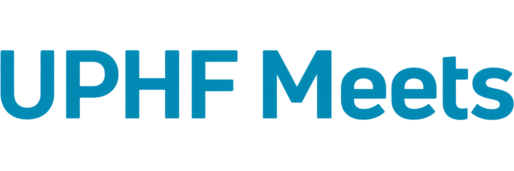
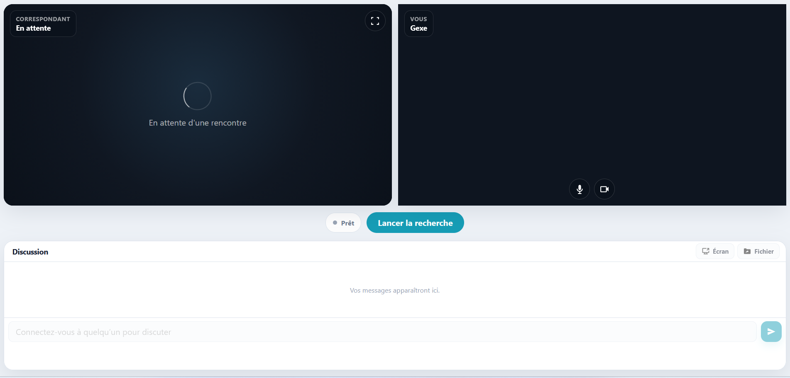
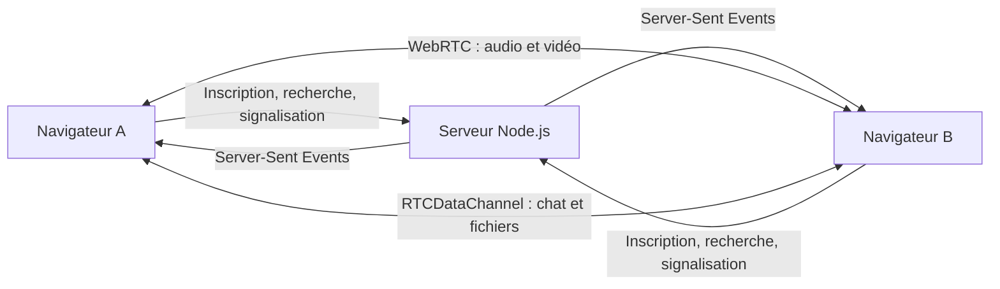

<div align="center">



### Rencontres vidéo P2P entre étudiants

Projet universitaire réalisé en **Licence Informatique — année 2023–2024**

<br>


</div>

---

## À propos

**UPHF Meets** est un projet universitaire imaginé et développé dans le cadre de ma **Licence Informatique durant l'année 2023–2024**.

Le projet part d'un constat simple : à l'université, créer spontanément du lien n'est pas toujours évident. L'arrivée dans un nouvel établissement, les différences de filière ou d'emploi du temps et le fait de ne pas encore connaître beaucoup de monde peuvent rendre les premières interactions plus difficiles.

UPHF Meets a donc été pensé comme un espace de **rencontre vidéo spontanée entre étudiants**, dans l'esprit d'un chatroulette universitaire, mais avec une finalité centrée sur la vie étudiante : discuter, faire connaissance, rompre l'isolement, échanger des conseils et éventuellement trouver de l'**entraide autour des cours, des projets ou de la vie sur le campus**.

La version actuelle fonctionne entièrement en local et repose sur une architecture **peer-to-peer avec WebRTC**. Le serveur assure le matchmaking et la signalisation, tandis que l'audio, la vidéo, le chat et les fichiers sont échangés directement entre les deux navigateurs une fois la connexion établie.

---

## Aperçu

<p align="center">
  
</p>

L'interface conserve les deux flux vidéo au premier plan, avec la conversation écrite et les actions essentielles accessibles sur le même écran : recherche d'un correspondant, microphone, caméra, plein écran, partage d'écran et transfert de fichiers.

---

## Fonctionnalités

### Rencontre vidéo

- **Matchmaking aléatoire** entre les utilisateurs actuellement disponibles.
- Appels **audio et vidéo peer-to-peer** via WebRTC.
- Affichage du nom du correspondant pendant la rencontre.
- Activation ou désactivation du **microphone** et de la **caméra**.
- Affichage de la vidéo distante en **plein écran**.
- **Partage d'écran** pendant une conversation.

### Discussion et partage

- **Chat texte P2P** via `RTCDataChannel`.
- Envoi d'un message avec le bouton dédié ou la touche `Entrée`.
- **Transfert de fichiers P2P** directement entre les deux navigateurs.
- Progression visible pendant l'envoi d'un fichier.
- Limite actuelle de **20 Mo par fichier**.

### Matchmaking dynamique

Le bouton **Personne suivante** met fin à la rencontre actuelle et relance immédiatement une recherche.

La personne qui vient d'être passée est également replacée automatiquement dans la file d'attente. Pour éviter qu'une même paire ne soit reformée instantanément — particulièrement lors d'un test local avec seulement deux utilisateurs — le serveur applique un **court délai anti-rematch de 5 secondes**.

Il ne s'agit pas d'une blacklist : les deux utilisateurs peuvent parfaitement se retrouver plus tard.

### Expérience utilisateur

- Séquence d'introduction animée propre au projet.
- Écran d'entrée avec saisie du nom et du prénom.
- Interface desktop pensée pour afficher **les vidéos et le chat sans navigation supplémentaire**.
- États visuels : prêt, recherche, connecté et erreur.
- Indication d'attente lorsqu'aucun correspondant n'est encore connecté.
- Notifications discrètes lors des changements de rencontre ou des erreurs.

---

## Architecture



### Rôle du serveur

Le serveur Node.js :

- sert l'interface web ;
- maintient la file d'attente ;
- forme les paires d'utilisateurs ;
- gère le changement de correspondant ;
- relaie les offres, réponses et candidats ICE nécessaires à la négociation WebRTC ;
- transmet les événements temps réel au navigateur avec **Server-Sent Events**.

### Rôle de WebRTC

Après la phase de signalisation :

- l'audio et la vidéo utilisent une connexion WebRTC entre les pairs ;
- le chat et les fichiers utilisent un `RTCDataChannel` ;
- le serveur applicatif n'est pas utilisé comme relais du contenu des conversations.

---

## Stack technique

| Partie | Technologie |
| --- | --- |
| Serveur | Node.js 18+ |
| Frontend | HTML5, CSS3, JavaScript vanilla |
| Temps réel serveur → client | Server-Sent Events |
| Signalisation WebRTC | API HTTP locale |
| Audio / vidéo | WebRTC |
| Chat / fichiers | RTCDataChannel |
| Caméra / microphone | MediaDevices API |
| Partage d'écran | Screen Capture API |

Le projet ne dépend actuellement d'**aucun package npm externe**. Le serveur utilise uniquement les modules natifs de Node.js.

---

## Structure du projet

```text
UPHF-Meets/
├── docs/
│   ├── assets/
│   │   └── uphf-meets-logo.png
│   └── screenshots/
│       └── main-interface.png
│
├── fichier.png
├── index.html
├── logo.gif
├── logo_uphf.png
├── partage.png
├── script.js
├── server.js
├── style.css
├── texte.gif
│
├── .gitattributes
├── .gitignore
├── package-lock.json
├── package.json
└── README.md
```

---

## Installation

### Prérequis

- **Node.js 18 ou supérieur** ;
- npm ;
- un navigateur moderne compatible WebRTC ;
- une caméra et un microphone pour tester la visioconférence.

Vérifier les versions installées :

```bash
node --version
npm --version
```

### Cloner le dépôt

```bash
git clone https://github.com/ge-xe/UPHF-Meets.git
cd UPHF-Meets
```

### Installer

```bash
npm install
```

Aucune dépendance externe n'est actuellement requise, mais la commande permet de valider l'environnement npm et le lockfile du projet.

### Lancer

```bash
npm start
```

Le serveur est ensuite accessible à l'adresse :

```text
http://localhost:3000
```

---

## Tester le matchmaking en local

Le comportement peut être reproduit sur une seule machine.

1. Lancer le serveur avec `npm start`.
2. Ouvrir `http://localhost:3000` dans deux navigateurs ou deux profils de navigateur différents.
3. Entrer un nom différent dans chaque fenêtre.
4. Cliquer sur **Lancer la recherche** dans les deux fenêtres.
5. Autoriser l'accès à la caméra et au microphone.

Pour un test confortable, utiliser par exemple **Chrome + Firefox** permet de simuler deux utilisateurs distincts sur le même ordinateur.

> `localhost` est adapté au test des APIs média du navigateur. Pour une utilisation entre plusieurs appareils ou un déploiement réel, une configuration HTTPS et une infrastructure ICE adaptée seraient nécessaires.

---

## Configuration ICE optionnelle

Par défaut, la version locale n'impose aucun serveur STUN/TURN externe.

Le serveur accepte néanmoins une configuration ICE via la variable d'environnement `ICE_SERVERS_JSON` afin de préparer un déploiement plus réaliste.

Exemple conceptuel :

```json
[
  {
    "urls": "stun:stun.example.org:3478"
  }
]
```

Les identifiants TURN ne doivent jamais être stockés directement dans le dépôt.

---

## Connexion ENT : évolution envisagée

Le bouton **Se connecter avec l'ENT** présent dans l'interface correspond à une évolution imaginée pendant la conception du projet. L'authentification avec le portail universitaire n'est pas activée dans cette version locale.

Une intégration réelle à l'ENT aurait apporté un intérêt important au concept : **associer chaque utilisateur à une identité étudiante vérifiée plutôt qu'à un profil totalement anonyme**.

Cela aurait permis d'imaginer un environnement plus rassurant et mieux adapté à un usage universitaire, notamment avec :

- connexion via le compte institutionnel de l'étudiant ;
- identité vérifiée et réduction de l'anonymat abusif ;
- recherche de correspondants par **filière** ;
- recherche par **année d'études** ;
- rencontres entre étudiants suivant certains enseignements communs ;
- espaces davantage orientés vers l'**entraide académique** ;
- mécanismes de signalement et de modération rattachés à des comptes identifiés.

L'objectif aurait été de conserver la spontanéité d'une rencontre aléatoire tout en l'inscrivant dans un cadre universitaire plus sûr et plus utile.

---

## Autres pistes d'évolution

- Déploiement HTTPS public.
- Infrastructure **STUN/TURN** pour améliorer la connectivité WebRTC sur Internet.
- Authentification institutionnelle via l'ENT / SSO universitaire.
- Filtres de mise en relation par filière, niveau ou centres d'intérêt.
- Système de signalement et de modération.
- Préférences de disponibilité et de type de rencontre.
- Historique facultatif des contacts ou demandes d'ajout, avec respect de la vie privée.
- Interface mobile dédiée.

---

## Limites de la version actuelle

Cette version est avant tout une **démonstration locale du concept universitaire** :

- l'identité repose sur le nom saisi par l'utilisateur ;
- l'authentification ENT n'est pas implémentée ;
- aucune base de données ne conserve les profils ou les conversations ;
- aucun mécanisme de modération n'est intégré ;
- aucun serveur TURN public n'est fourni ;
- le projet est destiné au test et à la démonstration, pas à un déploiement public en production dans son état actuel.

---

## Contexte académique

UPHF Meets a été réalisé dans le cadre de ma **Licence Informatique, année universitaire 2023–2024**.

Au-delà de l'aspect technique, le projet cherchait à proposer une réponse numérique à une question de vie étudiante : **comment faciliter les premiers échanges entre étudiants qui ne se seraient peut-être jamais parlé autrement ?**

La visioconférence aléatoire sert ici de point de départ à des usages plus larges : créer du lien, découvrir d'autres étudiants de l'université et favoriser l'entraide dans un cadre qui pourrait, à terme, être relié à l'écosystème numérique de l'établissement.

---

<div align="center">


**Projet universitaire — Licence Informatique 2023–2024**

</div>
